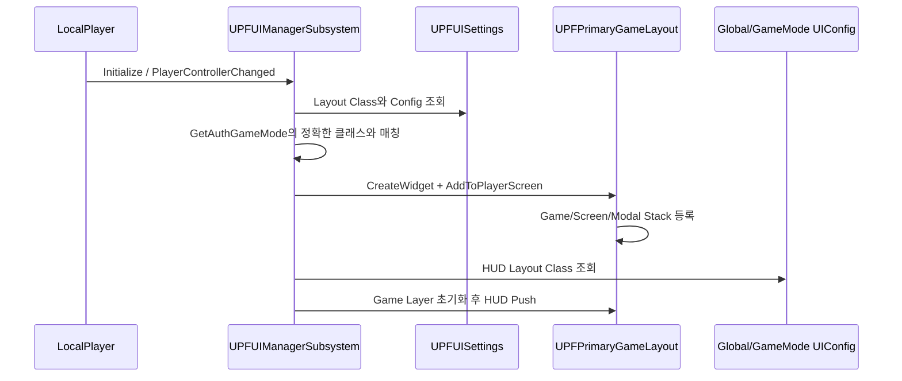
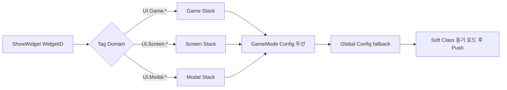
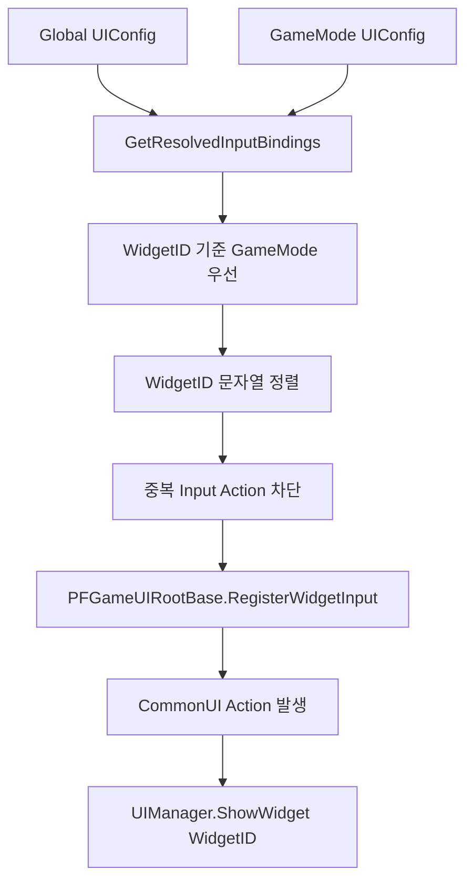

# CommonUI 기반 UI 프레임워크

## 문서 범위와 검증 상태

이 문서는 공개 저장소 `main@541c9e1`의 C++ 소스를 기준으로 작성했습니다. `PrimaryGameLayout` Blueprint, CommonInput DataTable, UI Config Data Asset, 프로젝트 설정은 저장소에 없으므로 에셋 내부 연결과 실제 입력 동작은 **검증되지 않은 영역**입니다.

현재 코드로 확인되는 핵심은 LocalPlayer 단위 UI 관리, 세 개의 Activatable Widget Stack, Gameplay Tag 라우팅, Global/GameMode Config 병합, Config 기반 입력 Action 등록입니다.

## 1. 구현 목적과 요구사항

- 월드가 바뀌어도 LocalPlayer 관점에서 UI 진입점을 일관되게 유지한다.
- HUD, 전체 화면, 모달의 활성화 순서와 Back/포커스 처리를 CommonUI Stack에 맡긴다.
- 외부 시스템이 구체적인 WBP 클래스와 Stack을 알지 않고 `WidgetID`만으로 화면을 요청하게 한다.
- 공용 UI와 GameMode 전용 UI를 같은 Config 형식으로 정의하고, 모드별 설정이 공용 설정을 덮어쓰게 한다.
- 각 위젯 정의에 선택적으로 입력 Action을 연결해 Root가 실행 시 바인딩하게 한다.

## 2. 핵심 클래스와 책임

| 클래스 | 책임 | 코드 |
| --- | --- | --- |
| `UPFActivatableWidget` | Back Handler, 포커스 복원, 화면별 입력 모드·마우스 캡처·이동/시점 차단 정책 | [header](../Project_SIH/003_UI/000_Foundation/PFActivatableWidget.h), [source](../Project_SIH/003_UI/000_Foundation/PFActivatableWidget.cpp) |
| `UPFGameUIRootBase` | 해석된 UI 입력 바인딩을 CommonUI에 등록하고 `WidgetID` 표시 요청으로 변환 | [header](../Project_SIH/003_UI/000_Foundation/PFGameUIRootBase.h), [source](../Project_SIH/003_UI/000_Foundation/PFGameUIRootBase.cpp) |
| `UPFUISettings` | Primary Layout, Global Config, 정확히 일치하는 GameMode 클래스별 Config 설정 | [header](../Project_SIH/003_UI/001_Config/PFUISettings.h) |
| `UPFUIConfig` | HUD 클래스와 `UI.Game / UI.Screen / UI.Modal`별 위젯 정의 보관 | [header](../Project_SIH/003_UI/001_Config/PFUIConfig.h), [source](../Project_SIH/003_UI/001_Config/PFUIConfig.cpp) |
| `UPFUIManagerSubsystem` | Layout 생명주기, Config 선택·우선순위, 태그 기반 Layer 라우팅, 위젯 클래스 로드 | [header](../Project_SIH/003_UI/002_Subsystem/PFUIManagerSubsystem.h), [source](../Project_SIH/003_UI/002_Subsystem/PFUIManagerSubsystem.cpp) |
| `UPFPrimaryGameLayout` | Gameplay Tag와 `UCommonActivatableWidgetStack` 연결, Push/Clear, 현재 활성 위젯 조회 | [header](../Project_SIH/003_UI/PFPrimaryGameLayout.h), [source](../Project_SIH/003_UI/PFPrimaryGameLayout.cpp) |

## 3. Layout 생성과 화면 표시 흐름

월드가 달라지면 기존 Layout을 Viewport에서 제거한 뒤 새 Controller의 World에 다시 생성합니다. 같은 World에서 Config 객체가 바뀌면 모든 Stack을 비우고 HUD를 다시 표시합니다.

## 4. 위젯별 동적 입력 등록

`FPFUIWidgetDefinition`은 위젯의 Soft Class와 선택적 `Open Input Action`을 함께 보관합니다. `UPFGameUIRootBase::NativeOnInitialized`는 UIManager가 계산한 바인딩을 순회해 `RegisterUIActionBinding`을 호출합니다.

구현상 우선순위는 다음과 같습니다.

1. GameMode Config의 모든 유효 입력 바인딩을 먼저 추가합니다.
2. Global Config에서 GameMode가 같은 Widget ID를 정의한 항목은 제외합니다.
3. 이미 등록된 동일 DataTable/Row 입력 Action은 로그를 남기고 제외합니다.
4. 바인딩은 `ECommonInputMode::All`, 입력 소비 활성화로 등록됩니다.

따라서 “위젯별 동적 입력”은 각 위젯 인스턴스가 스스로 입력을 등록한다는 뜻이 아니라, **위젯 정의별 Action을 HUD Root가 현재 Config에 맞춰 한 번 등록하는 구조**입니다.

## 5. 입력 모드와 CommonUI 활성화 정책

`UPFActivatableWidget`은 클래스 기본값으로 `Menu / All / Game` 입력 모드와 마우스 캡처 정책을 설정할 수 있습니다. Menu 모드에서는 이동과 시점 입력을 항상 차단하며, 모든 파생 위젯은 기본적으로 Back Handler와 자동 포커스 복원을 사용합니다.

이 방식으로 입력 정책은 화면 클래스에, 어떤 화면을 어떤 키로 여는지는 UI Config에 분리됩니다.

## 6. 코드 및 커밋 근거

### 공개 저장소

- CommonUI 경로가 처음 포함된 스냅샷: [10월 6일 코드 업로드](../../../commit/210ab0755289ff70a8dce0bf375c659cff98d502)
- 현재 기준 스냅샷: [10월 22일 코드 적용](../../../commit/541c9e1d04c71e9c7b16bdaf5c212c8150d38d7d)

현재 저장소 이력은 기능별 커밋이 아니라 코드 업로드 스냅샷이므로, 위 링크만으로 세부 변경 과정은 확인할 수 없습니다.

### 원본 팀 Git에서 확인한 `Fsbsnw` 커밋

| 커밋 | 확인된 범위 |
| --- | --- |
| `b6a1181` | CommonUI UI Root와 GameMode별 HUD 구성 |
| `e144c2e` | 조사 UI 입력, 단계 전환, 단서 제출 흐름 확장 |
| `230186a` | Global UI Config와 GameMode 우선 조회 |
| `8f34c8a` | Config 기반 입력 라우팅과 화면 진입 책임 정리 |

원본 팀 저장소의 다른 작성자도 전투 HUD, 파티 편성, 결과 화면 등 `003_UI` 하위 경로를 수정했습니다. 따라서 이 문서는 위 네 커밋과 현재 코드로 확인되는 공용 프레임워크 범위를 `Fsbsnw` 작업 근거로 삼고, 모든 UI를 개인 작업으로 주장하지 않습니다. 또한 Git 작성자 정보만으로 AI 보조 여부나 수동 작성 비율은 판단하지 않습니다.

## 7. 결과와 기술적 한계

### 코드로 확인되는 결과

- LocalPlayer 단위 단일 UI 진입점
- Game/Screen/Modal의 명시적 계층 분리
- 의미 태그 기반 화면 호출로 시스템과 WBP 클래스 결합 축소
- Global/GameMode 설정 병합과 충돌 방지
- CommonUI 활성 위젯의 Back·포커스·입력 모드 정책 통일

### 한계 및 추가 확인 사항

- Config와 WBP가 없으므로 `BindWidget` Stack, 입력 DataTable Row, 실제 위젯 매핑을 검증할 수 없습니다.
- 위젯 Soft Class는 `LoadSynchronous`로 로드하므로 첫 호출 프레임의 지연 가능성을 측정해야 합니다.
- GameMode 조회에 `GetAuthGameMode`를 사용해 멀티플레이 클라이언트 전용 환경은 검증되지 않았습니다.
- Root 입력은 `NativeOnInitialized`에서 등록됩니다. 같은 Root 인스턴스를 유지한 채 런타임 Config만 교체할 때 기존 바인딩 갱신 경로는 보이지 않습니다.
- CommonUI/UIManager 전용 자동화 테스트는 현재 분리 저장소에서 확인되지 않습니다.
- `GetDesiredInputConfig`가 매 호출 Warning 로그를 남기므로 배포 구성에서 로그 정책을 점검할 필요가 있습니다.

