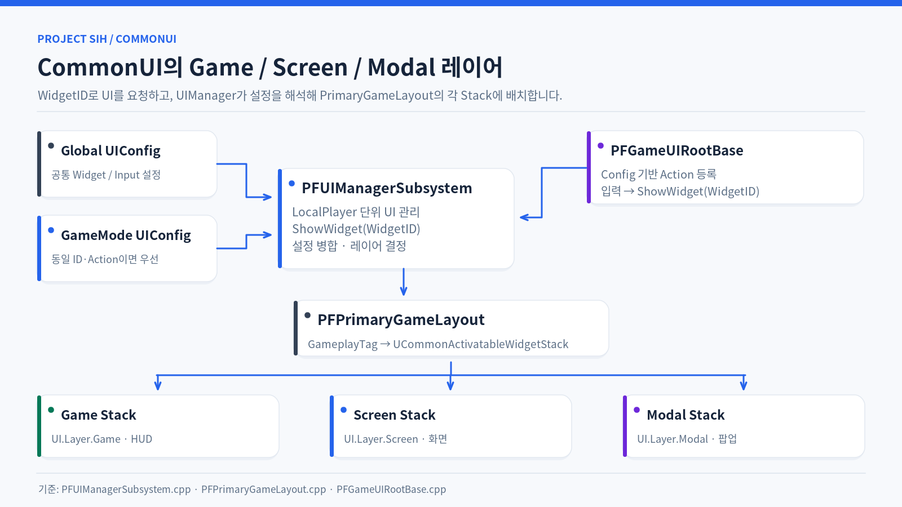

# CommonUI 기반 UI 관리

[← README](../README.md)

Project SIH에서는 CommonUI를 사용해 화면 활성화·Back·포커스 처리를 관리하고 프로젝트별 입력 설정을 확장했습니다.

> 

## 화면 진입과 설정

`UI Input Action → Root 입력 바인딩 → UIManager(WidgetID) → UIConfig → PrimaryGameLayout Stack`

- `UPFUIManagerSubsystem`이 LocalPlayer 단위로 Layout 수명과 화면 요청을 관리합니다.
- `UPFPrimaryGameLayout`에 Game·Screen·Modal Stack을 두고 GameplayTag로 계층을 식별합니다.
- Global 설정과 GameMode별 UIConfig를 병합하며, 충돌하면 모드별 설정을 우선합니다.
- `UPFGameUIRootBase`가 UIConfig에서 Open Input Action을 읽고 실행 시 바인딩합니다.

## 주요 코드

- [PFUIManagerSubsystem.cpp](../Project_SIH/003_UI/002_Subsystem/PFUIManagerSubsystem.cpp)
- [PFPrimaryGameLayout.cpp](../Project_SIH/003_UI/PFPrimaryGameLayout.cpp)
- [PFGameUIRootBase.cpp](../Project_SIH/003_UI/000_Foundation/PFGameUIRootBase.cpp)
- [PFUIConfig.h](../Project_SIH/003_UI/001_Config/PFUIConfig.h)
