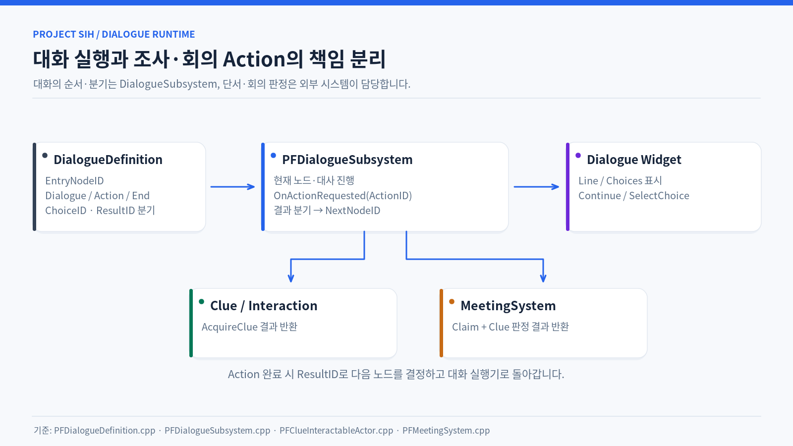
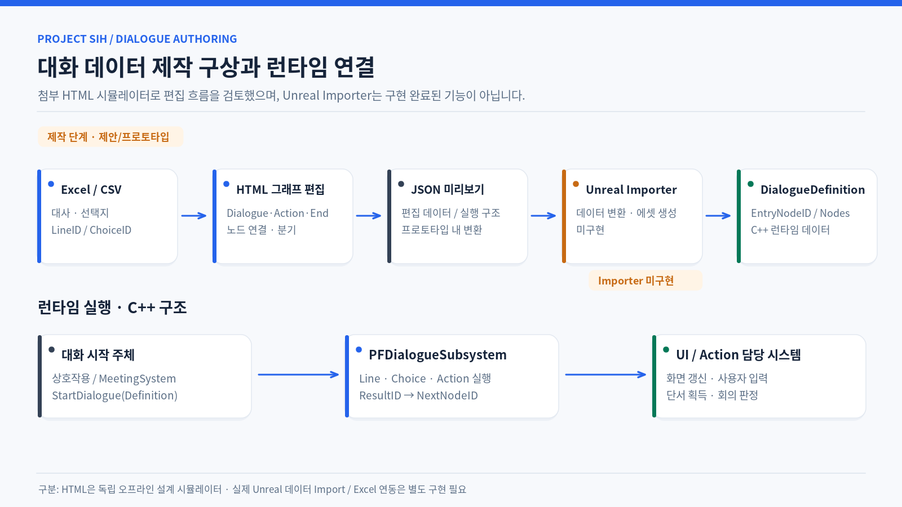
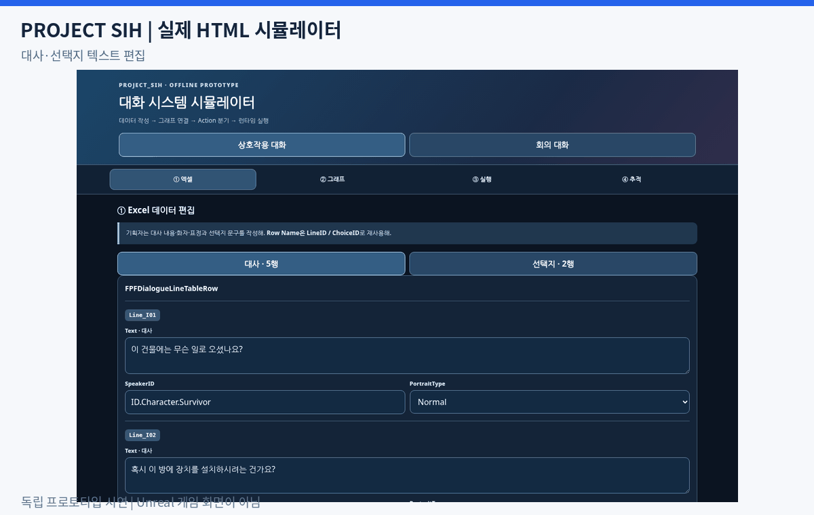

# DialogueSubsystem 기반 대화 시스템

[← README](../README.md)

조사와 회의에서 같은 대화 실행기를 사용할 수 있도록 **대화의 진행·분기**와 **실제 게임플레이 판정**을 분리했습니다.

> 

## 데이터와 실행

- `UPFDialogueDefinition`은 Dialogue·Action·End 노드와 시작 노드를 데이터로 보관합니다.
- `UPFDialogueSubsystem`은 현재 대사와 선택지를 UI에 전달하고, Choice ID로 다음 노드를 선택합니다.
- 외부 처리가 필요한 Action 노드는 요청을 전달한 뒤 Result ID를 받아 분기합니다.
- 조사 단서 획득과 회의 단서 제출은 각각 담당 시스템이 판정하고 결과만 대화 실행기로 돌려줍니다.

`대화 노드 → 선택지 / Action 요청 → 외부 시스템 결과 → 다음 노드 또는 종료`

## 대화 데이터 제작 방식 검토

대화 시스템의 런타임 구조뿐 아니라, 기획자가 대사와 선택지, 분기 데이터를 효율적으로 작성할 수 있는 방법을 함께 검토했습니다.

대사·선택지 텍스트는 Excel/CSV로 관리하고, Dialogue·Action·End 노드의 연결과 결과별 분기는 그래프 형태로 구성하는 제작 방식을 구상했습니다.

이 구조를 검토하기 위해 **HTML 기반 대화 시뮬레이터**를 제작했으며, 데이터 편집, 노드 연결, 선택지 및 Action 결과에 따른 분기 실행을 확인할 수 있도록 했습니다.

> 

> 

※ HTML 시뮬레이터는 설계 검토용 프로토타입이며, Unreal과 연결되는 자동 Importer는 구현 범위에 포함되지 않습니다.

## 주요 코드

- [PFDialogueTypes.h](../Project_SIH/000_Core/001_Contracts/006_Dialogue/PFDialogueTypes.h)
- [PFDialogueDefinition.cpp](../Project_SIH/001_Data/000_Definitions/PFDialogueDefinition.cpp)
- [PFDialogueSubsystem.cpp](../Project_SIH/002_Systems/011_Dialogue/PFDialogueSubsystem.cpp)
- [PFMeetingSystem.cpp](../Project_SIH/002_Systems/001_Investigation/PFMeetingSystem.cpp)
