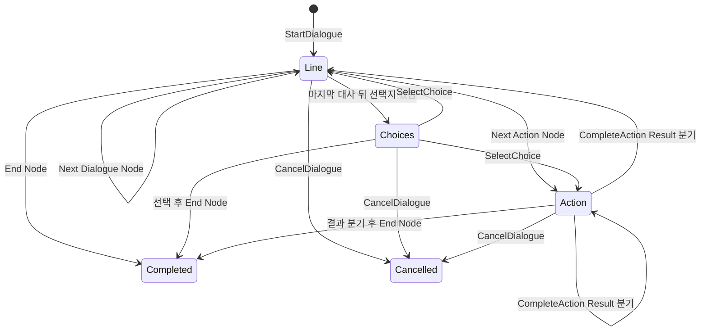
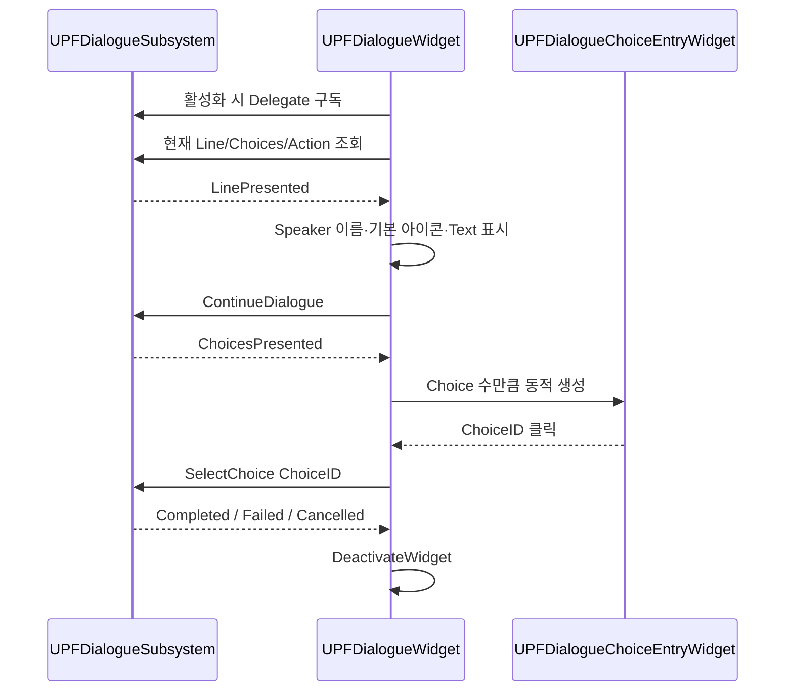
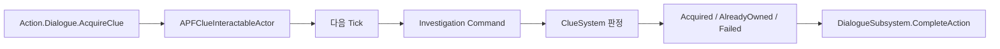
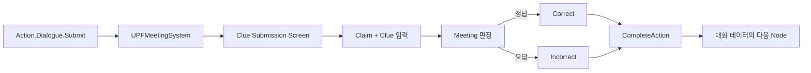

# DialogueSubsystem 기반 대화 시스템

## 현재 상태 요약

현재 저장소에는 데이터 계약, 정적 검증, WorldSubsystem 실행기, CommonUI 기반 표시 위젯, 단서 조사·회의 Action 연동 코드가 있습니다. 반면 Dialogue Data Asset, Blueprint 화면, 외부 그래프/HTML 제작 도구, 현재 구조 전용 자동화 테스트는 포함되어 있지 않습니다.

따라서 이 문서에서는 **런타임 C++ 구현 확인**과 **콘텐츠 제작·E2E 검증 완료**를 구분합니다.

| 구분 | 상태 |
| --- | --- |
| Dialogue/Action/End 노드 데이터 계약 | 구현 확인 |
| 시작 전 구조·참조 검증 | 구현 확인 |
| 대사 진행, 선택지, Action 결과 분기, 완료/실패/취소 | 구현 확인 |
| CommonUI 테스트 위젯과 선택지 Entry | 구현 확인 |
| 단서 획득·회의 제출 Action 연결 | 구현 확인 |
| 실제 Dialogue Data Asset과 최종 WBP | 저장소에 없어 미검증 |
| 외부 HTML/그래프 제작 도구 및 Importer | 구현을 확인할 파일 없음 |
| 현재 구조 전용 자동화·PIE E2E | 근거 없음, 테스트 필요 |

## 1. 구현 목적과 요구사항

- 대화 콘텐츠와 런타임 실행 상태를 분리한다.
- 대사, 선택지, 외부 게임 로직 호출을 하나의 노드 흐름으로 표현한다.
- UI는 현재 표시 데이터만 받고, 조사·회의 같은 도메인 로직은 Action 실행 주체가 담당한다.
- 늦게 열린 UI도 현재 대사/선택지/Action 상태를 다시 조회해 표시할 수 있게 한다.
- 잘못된 노드 참조, 중복 ID, 오래된 UI 입력, 델리게이트 재진입을 방어한다.

## 2. 데이터 모델

[Dialogue Types](../Project_SIH/000_Core/001_Contracts/006_Dialogue/PFDialogueTypes.h)는 다음 런타임 계약을 정의합니다.

| 타입 | 주요 데이터 |
| --- | --- |
| `FPFDialogueLine` | Line ID, Speaker Gameplay Tag, Text, Portrait Variant |
| `FPFDialogueChoice` | Choice ID, 표시 Text, Next Node ID |
| `FPFDialogueActionBranch` | 외부 실행 결과 ID, Next Node ID |
| `FPFDialogueAction` | Action Gameplay Tag, 결과별 Branch 배열 |
| `FPFDialogueRuntimeNode` | `Dialogue / Action / End`, Lines, Choices, Next Node, Action |

`UPFDialogueDefinition`은 `UPrimaryDataAsset`으로 Dialogue ID, Data Version, Entry Node ID, `TMap<FName, FPFDialogueRuntimeNode>`를 보관합니다. [Definition 구현](../Project_SIH/001_Data/000_Definitions/PFDialogueDefinition.cpp)은 시작 전에 다음을 검사합니다.

- `ID.Dialogue.*` 도메인의 유효한 Primary Asset ID
- Data Version 1 이상
- Entry Node 존재
- 노드 유형별 필드 조합의 구조적 유효성
- 전체 대화에서 Line ID 중복 금지
- 각 노드 안 Choice ID와 Action Result ID 중복 금지
- Next/Choice/Action Branch의 대상 노드 존재
- Speaker ID가 `ID.Character.*` 도메인인지 확인

## 3. 실행 상태와 입력 계약

`UPFDialogueSubsystem`은 `UWorldSubsystem`이며 한 World에서 한 개의 대화를 실행합니다.

입력 결과는 `Accepted`, `WrongStep`, `StaleChoice`, `StaleAction`, `InvalidActionResultID`, `ActionBranchNotFound`, `ReentrantInput` 등으로 구분됩니다.

### 방어 로직

- 활성 대화 중 두 번째 `StartDialogue`는 `AlreadyActive`로 거부됩니다.
- 과거에 표시한 Choice ID를 다른 단계에서 다시 전달하면 `StaleChoice`로 구분합니다.
- Action 완료 시 요청 당시 Node ID를 함께 받아 오래된 비동기 응답을 차단합니다.
- 델리게이트 방송이나 내부 전이 중 입력은 `ReentrantInput`으로 거부합니다.
- 사용자 입력 없이 즉시 연결되는 노드 체인에서 같은 Node를 재방문하면 실패 처리해 무한 루프를 막습니다.

## 4. UI 표시 흐름

[Dialogue Widget](../Project_SIH/003_UI/006_Dialogue/PFDialogueWidget.cpp)은 활성화될 때 Subsystem 델리게이트를 구독하고 현재 상태를 즉시 조회합니다.

Speaker는 `UPFCharacterDefinition`에서 표시 이름과 기본 아이콘을 조회합니다. `FPFDialogueLine::PortraitVariant` 필드는 데이터 계약에는 존재하지만 현재 위젯에서는 사용하지 않습니다.

Action 결과 버튼을 화면에 표시하는 `m_bEnableActionTestControls`는 주석과 Category가 명시하는 테스트 기능입니다. 실제 게임에서는 도메인 시스템이 Action을 구독하고 결과를 반환하는 구조입니다.

## 5. 외부 Action 연동

### 조사 단서 획득

델리게이트 재진입을 피하기 위해 단서 획득은 다음 Tick에 수행됩니다. 코드는 [ClueInteractableActor](../Project_SIH/002_Systems/001_Investigation/PFClueInteractableActor.cpp)에서 확인할 수 있습니다.

### 회의 단서 제출

이 구조에서 Dialogue는 선택 순서와 종료 시점을, MeetingSystem은 도메인 판정을 담당합니다. 코드는 [MeetingSystem](../Project_SIH/002_Systems/001_Investigation/PFMeetingSystem.cpp)에서 확인할 수 있습니다.

## 6. 기획 데이터 제작 편의성

현재 C++에서 확인되는 제작 편의 요소는 다음과 같습니다.

- `UPrimaryDataAsset`과 `EditDefaultsOnly` 필드로 에디터 데이터 작성 가능
- Gameplay Tag Category 제한으로 Dialogue, Character, Action ID 도메인 구분
- `DisplayName`과 주석을 통한 필드 의미 노출
- Node Map과 Entry Node로 실행 순서 데이터화
- Choice와 Action Branch를 배열로 두어 코드 수정 없이 분기 추가 가능
- Data Version 필드와 실행 전 전체 참조 검증
- Character Definition을 통한 화자 이름·기본 초상화 재사용

그러나 헤더 주석의 “외부 그래프 툴에서 생성”이라는 문구만으로 제작 도구가 구현되었다고 볼 수 없습니다. 현재 저장소에는 HTML, JSON/CSV 스키마, Import Factory, Editor Graph 코드가 없습니다. 따라서 정확한 표현은 **외부 데이터가 생성할 수 있는 런타임 계약을 마련했다**이며, **외부 제작 도구를 완성했다**가 아닙니다.

## 7. 코드 및 커밋 근거

- [Dialogue Types](../Project_SIH/000_Core/001_Contracts/006_Dialogue/PFDialogueTypes.cpp)
- [Dialogue Definition](../Project_SIH/001_Data/000_Definitions/PFDialogueDefinition.cpp)
- [Dialogue Subsystem](../Project_SIH/002_Systems/011_Dialogue/PFDialogueSubsystem.cpp)
- [Dialogue Widget](../Project_SIH/003_UI/006_Dialogue/PFDialogueWidget.cpp)
- [Choice Entry Widget](../Project_SIH/003_UI/006_Dialogue/PFDialogueChoiceEntryWidget.cpp)
- [AssetManager의 Dialogue 조회](../Project_SIH/001_Data/001_AssetManagement/PFAssetManager.cpp)
- 공개 스냅샷 근거: [10월 22일 코드 적용](../../../commit/541c9e1d04c71e9c7b16bdaf5c212c8150d38d7d)

10월 22일 공개 스냅샷은 이전 `DialogueGraphAsset/Executor` 프로토타입을 제거하고 현재 Definition/Subsystem/Widget 구조로 바꾼 사실을 보여줍니다. 원본 팀 Git에서 `Fsbsnw`의 `3baacec` 커밋은 “StateTree 대안 검토용 대화 그래프 프로토타입”을 보존한 기록이지만, 현재 구조와 동일한 구현이 아닙니다.

현재 최종 대화 구조는 기능별 원본 커밋 계보가 이 포트폴리오 저장소에 유지되지 않았습니다. 공개 스냅샷 작성자가 `Fsbsnw`라는 사실은 코드 출처의 한 근거일 뿐, 수동 작성과 AI 생성·수정의 범위를 증명하지 않습니다. 지원 자료에 개인 기여로 적기 전 별도 확인이 필요합니다.

## 8. 구현 결과와 기술적 한계

### 구현 확인

- 데이터 검증 후 Entry Node부터 실행
- 다중 Line, Choice 분기, 비동기 Action 결과 분기
- 완료·실패·취소 이벤트와 현재 Presentation 조회
- 재진입·오래된 입력 방어
- CommonUI 테스트 화면과 동적 선택지 생성
- 조사·회의 시스템의 실제 Action 소비자 연결

### 구현 및 테스트 중으로 분류할 항목

- `UPFDialogueWidget`은 코드 주석상 테스트용 기반이며 최종 UI 완료 근거가 없습니다.
- `UPFClueSubmissionWidget`의 Claim은 테스트 태그 두 개로 고정되어 있습니다.
- 현재 저장소에는 Dialogue 전용 자동화 테스트와 Dialogue Data Asset이 없습니다.
- Blueprint의 BindWidget 구성, 입력 포커스, Gamepad, 로컬라이징, 실제 초상화 전환은 검증되지 않았습니다.
- 한 World에서 동시에 하나의 대화만 지원합니다.
- Data Version 값은 검사하지만 버전별 마이그레이션 로직은 없습니다.
- 데이터 검증은 대상 노드 존재를 확인하지만 모든 노드의 도달 가능성이나 사용자 입력을 거치는 순환 구조까지 분석하지는 않습니다.
- Action Node는 요청 델리게이트 구독자가 없으면 실패합니다. 누가 어떤 Action을 소비하는지 등록 상태를 진단하는 도구는 없습니다.
- `StartDialogue`는 데이터 검증 후 Entry 진입에서 런타임 실패가 발생해도 호출 결과 자체는 `Accepted`를 반환하고 Failed 이벤트로 알립니다. 호출부는 이벤트와 활성 상태를 함께 확인해야 합니다.

