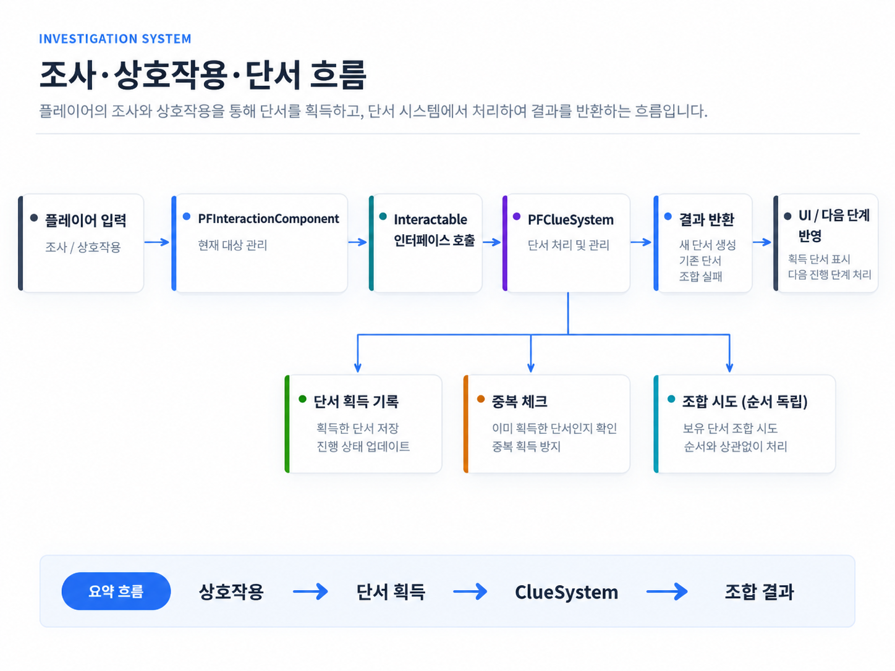
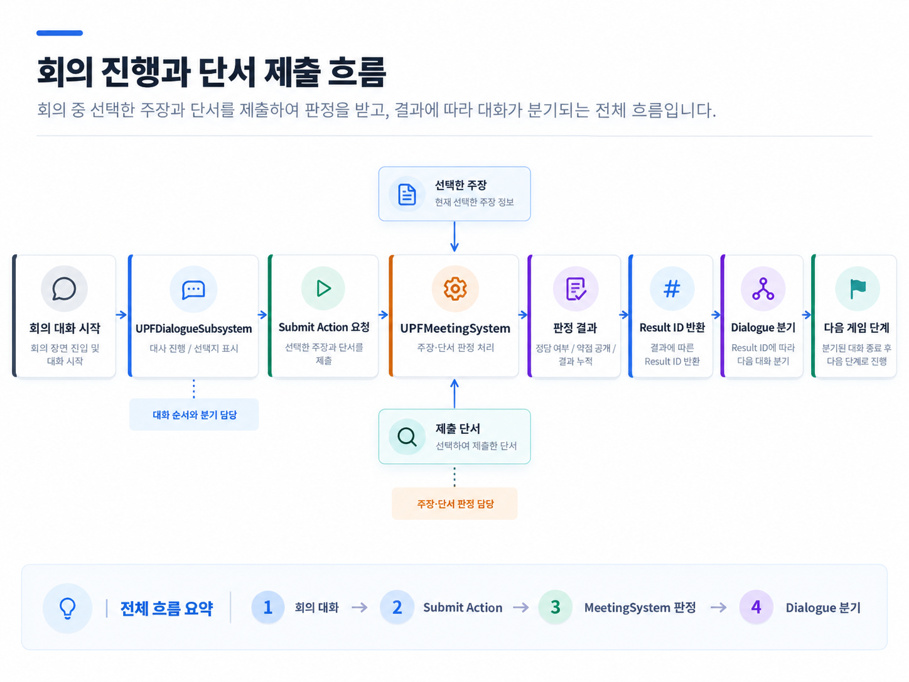

# 조사·상호작용·회의 시스템

[← README](../README.md)

상호작용으로 단서를 획득·조합하고, 회의에서 주장에 맞는 단서를 제출해 결과를 다음 게임 단계로 전달합니다.

> 

## 주요 구현

- **상호작용:** InteractionComponent가 현재 대상을 관리하고 Interactable 인터페이스를 호출합니다.
- **단서 관리:** ClueSystem이 획득·중복·순서 독립 조합과 시도 결과를 처리합니다.
- **회의 판정:** MeetingSystem이 주장·단서의 정답 여부를 판정하고 공개한 약점을 결과에 누적합니다.
- **대화와의 경계:** 회의의 대사 순서와 분기는 대화 데이터가 담당하고, 제출 Action의 판정 결과는 MeetingSystem에서 반환합니다.

`상호작용 → ClueSystem → 회의 대화 → Submit Action → MeetingSystem 판정 → Dialogue 분기`

> 

## 주요 코드

- [PFInteractionComponent.cpp](../Project_SIH/002_Systems/006_Interaction/PFInteractionComponent.cpp)
- [PFClueSystem.cpp](../Project_SIH/002_Systems/001_Investigation/PFClueSystem.cpp)
- [PFMeetingSystem.cpp](../Project_SIH/002_Systems/001_Investigation/PFMeetingSystem.cpp)
- [PFClueDefinition.h](../Project_SIH/001_Data/000_Definitions/PFClueDefinition.h)
