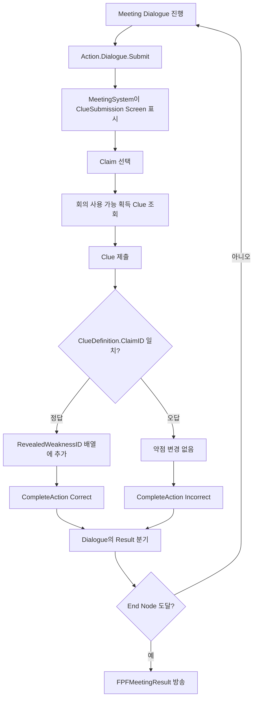

# 상호작용·조사·회의 시스템

## 문서 범위와 검증 상태

이 문서는 범위 상호작용에서 단서 획득·조합, 조사 종료, 회의 대화와 단서 제출, 약점 결과 방송까지의 C++ 경로를 다룹니다. Blueprint 액터, 조사 맵, Clue/Case/Dialogue Data Asset은 현재 저장소에 없으므로 실제 데이터 값과 전체 플레이 연결은 검증 대상에서 제외했습니다.

## 1. 구현 목적과 요구사항

- 상호작용 감지, 조사 규칙, 회의 판정, 전체 페이즈 전환의 책임을 분리한다.
- 사건·단서·주장·약점을 Gameplay Tag로 식별하고 시스템 경계에서 태그 도메인을 검증한다.
- 단서 획득과 조합 실패 원인을 enum으로 구분해 UI가 결과를 해석할 수 있게 한다.
- 회의는 제출 결과만 판정하고, 어떤 주장을 언제 보여주며 언제 끝낼지는 대화 데이터가 결정하게 한다.
- 조사와 회의의 결과를 Gameplay Message로 GameFlow에 전달한다.

## 2. 핵심 클래스와 책임

| 영역 | 클래스 | 책임 |
| --- | --- | --- |
| 상호작용 | `APFInteractableActor` | Sphere Overlap으로 PlayerController의 InteractionComponent에 자신을 등록·해제 |
| 상호작용 | `UPFInteractionComponent` | 한 개의 현재 대상 보관, `Interact` 호출 전달, 겹치는 두 번째 대상 거부 |
| 단서 액터 | `APFClueInteractableActor` | 직접 단서 획득 또는 대화 시작, AcquireClue Action 결과를 대화에 반환 |
| 진입점 | `APFInvestigationGameMode` | 조사·회의 시스템 생성, Entry/Command 인터페이스 요청 위임, Ready 메시지 방송 |
| 조사 | `UPFInvestigationSystem` | 활성 Case와 ClueSystem 소유, 조사 완료·생략 결과 생성 |
| 단서 | `UPFClueSystem` | 획득·중복 방지·조합 레시피·조합 시도 기록 |
| 회의 | `UPFMeetingSystem` | 회의 대화 시작, 주장/단서 판정, 약점 누적, 회의 결과 방송 |
| 데이터 | `UPFClueDefinition` | 조합식, 회의 사용 여부, 반박 Claim, 공개 Weakness |
| 데이터 | `UPFCaseDefinition` | Case ID, 회의 Dialogue ID, Boss Encounter 정보 |

주요 코드는 [InteractionComponent](../Project_SIH/002_Systems/006_Interaction/PFInteractionComponent.cpp), [ClueInteractableActor](../Project_SIH/002_Systems/001_Investigation/PFClueInteractableActor.cpp), [InvestigationSystem](../Project_SIH/002_Systems/001_Investigation/PFInvestigationSystem.cpp), [ClueSystem](../Project_SIH/002_Systems/001_Investigation/PFClueSystem.cpp), [MeetingSystem](../Project_SIH/002_Systems/001_Investigation/PFMeetingSystem.cpp)에서 확인할 수 있습니다.

## 3. 상호작용과 단서 획득 흐름

```mermaid
sequenceDiagram
    participant Pawn as Player Pawn
    participant Actor as APFClueInteractableActor
    participant IC as UPFInteractionComponent
    participant DS as UPFDialogueSubsystem
    participant GM as Investigation Command Receiver
    participant IS as UPFInvestigationSystem
    participant CS as UPFClueSystem

    Pawn->>Actor: Sphere BeginOverlap
    Actor->>IC: TryRegisterInteractable
    IC->>Actor: TryInteract → Interact
    alt Dialogue ID 없음
        Actor->>GM: TryAcquireClue
    else Dialogue ID 있음
        Actor->>DS: StartDialogue
        DS-->>Actor: Action.Dialogue.AcquireClue
        Actor->>Actor: 다음 Tick에 Action 실행
        Actor->>GM: TryAcquireClue
    end
    GM->>IS: TryAcquireClue
    IS->>CS: TryAcquireClue
    CS-->>Actor: Acquired / AlreadyOwned / 실패 enum
    Actor->>DS: CompleteAction(NodeID, ResultID)
```

Action 요청 델리게이트 방송 중에는 대화 입력이 재진입으로 거부됩니다. 단서 액터는 이를 피하기 위해 AcquireClue Action을 다음 Tick에 실행하고 `Acquired`, `AlreadyOwned`, `Failed` 중 하나를 반환합니다.

현재 InteractionComponent는 단일 대상만 지원하며, 서로 다른 두 상호작용 범위가 겹치면 나중 대상을 거부하고 로그를 남깁니다.

## 4. 단서 획득과 조합

`UPFClueSystem`은 Case 시작 시 보유 단서와 조합 시도 기록을 초기화합니다.

- 획득: `ID.Clue.*` 도메인, Definition 존재, 중복 여부를 검사합니다.
- 조합 입력: 최소 2개, 모두 보유, 각 Definition 존재, 조합 재료로 사용 가능해야 합니다.
- 레시피: AssetManager가 입력 태그 집합과 순서 독립으로 일치하는 결과 Definition을 찾습니다.
- 실패 기록: 처음 보는 잘못된 조합은 `RecipeUnavailable`, 같은 실패 조합은 이후 `AlreadyReviewed`를 반환합니다.
- 성공 기록: 결과 단서를 보유 목록에 추가하고 입력 집합·결과 ID를 기록합니다.

데이터 계약은 [ClueDefinition](../Project_SIH/001_Data/000_Definitions/PFClueDefinition.h)과 [ClueTypes](../Project_SIH/000_Core/001_Contracts/001_Investigation/PFClueTypes.h)에서 확인할 수 있습니다.

## 5. 조사 종료와 회의 진입

조사 완료 또는 생략 시 `UPFInvestigationSystem`은 활성 Case와 획득 단서를 `FPFInvestigationResult`로 만들고 서로 다른 Gameplay Message 채널로 방송합니다. GameFlow가 이 결과를 받아 회의로 진입하거나 파티 편성으로 건너뜁니다.

회의 시작 시 `UPFMeetingSystem`은 다음 순서로 준비합니다.

1. Case와 획득 단서 태그를 검증합니다.
2. `UPFCaseDefinition::MeetingDialogueID`로 대화 Definition을 조회합니다.
3. World의 `UPFDialogueSubsystem`이 비활성 상태인지 확인합니다.
4. 완료와 Action 요청 델리게이트를 구독한 뒤 대화를 시작합니다.

## 6. 대화가 주도하는 회의 판정



MeetingSystem은 Claim 목록, 반복 횟수, 다음 선택 지점, 종료 조건을 보유하지 않습니다. 대화의 Action Node가 제출 시점을 만들고, `Correct / Incorrect` 결과 분기가 다음 노드를 결정합니다. MeetingSystem은 현재 입력 단계와 제출 유효성, Claim-Clue 일치 여부만 책임집니다.

정답인 경우 `UPFClueDefinition::RevealedWeaknessID`를 `TArray`에 추가합니다. `AddUnique`가 아니므로 같은 약점이 여러 슬롯/정답에서 반복될 수 있는 계약입니다.

## 7. UI와 데이터 제작 경계

`UPFClueSubmissionWidget`은 GameMode의 `IPFMeetingCommandReceiver`만 호출하고 MeetingSystem 내부 상태를 직접 참조하지 않습니다. 제출 후보는 획득 단서 중 `MeetingUsable`인 Definition만 반환됩니다.

다만 현재 위젯의 Claim 목록은 `ID.Claim.DialogueTest.A/B` 두 개를 코드에서 생성하는 테스트 구현입니다. 실제 Claim 선택지를 Dialogue Widget이 직접 제공하거나 콘텐츠 데이터에서 공급하는 최종 UI는 현재 코드로 확인되지 않습니다.

Data Asset에서는 다음을 기획 데이터로 분리했습니다.

- 단서 표시 이름
- 순서 없는 조합 재료 집합
- 회의 제출 가능 여부
- 반박 대상 Claim
- 공개되는 Weakness
- Case별 Meeting Dialogue ID

이 필드들이 에디터에 노출되는 C++ 계약은 확인되지만, 실제 Data Asset과 기획자의 제작·검수 화면은 저장소에 포함되어 있지 않습니다.

## 8. 코드 및 커밋 근거

### 공개 저장소

- 조사·상호작용 경로가 포함된 초기 스냅샷: [9월 20일 코드 업로드](../../../commit/cc1dd0bd5456c49f5e456a6f861bf4dd155f998e)
- 대화 연동이 반영된 현재 스냅샷: [10월 22일 코드 적용](../../../commit/541c9e1d04c71e9c7b16bdaf5c212c8150d38d7d)

### 원본 팀 Git에서 확인한 `Fsbsnw` 커밋

| 커밋 | 확인된 변경 |
| --- | --- |
| `ea1fa5e` | Clue Definition과 ClueSystem 최소 API |
| `15e0e1f` | 조사 종료와 획득 단서 Result |
| `083df13` | 범위 상호작용과 단서 획득 경로 |
| `6eefb25` | ClueDefinition 기반 Claim-Clue 판정 |
| `8696fb5` | 고정 레시피 기반 단서 조합 |
| `6f9b1c2`, `8ae5a41` | 다중 Claim 흐름과 대화 주도 선택·회의 단서 필터링 |
| `d37159c` | 조합 시도 기록과 재검토 판정 |
| `0cc3867` | 공개 약점의 중복을 보존하는 배열 전환 |

GameFlow, AssetManager, 전투의 약점 적용은 여러 작성자가 수정한 팀 공용 영역입니다. 이 문서에서는 `Fsbsnw` 커밋으로 확인되는 조사·회의 로직과 접점만 개인 작업 근거로 사용합니다. 현재 대화 연동의 세부 수동 작성·AI 보조 범위는 스냅샷 작성자만으로 판정하지 않습니다.

## 9. 완료 범위와 한계

### C++ 구현으로 확인됨

- 단일 대상 범위 상호작용과 명령 전달
- 직접 획득 및 대화 Action을 통한 단서 획득 경로
- 단서 획득·순서 독립 조합·시도 기록
- 조사 완료/생략 결과 방송
- 회의 입력 상태, 단서 필터, Claim-Clue 판정, 약점 누적
- Dialogue Action 결과를 이용한 회의 분기와 종료 결과 방송

### 테스트 또는 통합 확인 필요

- 현재 분리 저장소에는 Clue/Meeting/Dialogue 전용 자동화 테스트가 없습니다.
- 포함된 [GameFlow 테스트](../Project_SIH/Private/Tests/GameFlow/PFGameFlowSubsystemTest.cpp)는 잘못된 Case 결과 무시, Meeting 결과 저장, PartyFormation 전환 등 플로우 경계를 검사하지만 실제 UI·대화·단서 판정을 실행하지는 않습니다.
- 원본 분석 자료에는 과거 Clue 조합과 Meeting/GameFlow 테스트 통과 기록이 있으나, 10월 22일 대화 교체 이후 현재 코드의 재실행 근거는 아닙니다.
- InteractionComponent는 겹친 대상의 우선순위·가까운 대상 선택을 지원하지 않습니다.
- GameMode의 `GetAuthGameMode`와 단일 LocalPlayer 접근을 사용하므로 멀티플레이·분할 화면은 검증되지 않았습니다.
- Claim 목록 하드코딩, Dialogue/Clue/Case Asset 부재, Blueprint 화면 부재 때문에 전체 콘텐츠 E2E 완료로 표현할 수 없습니다.

