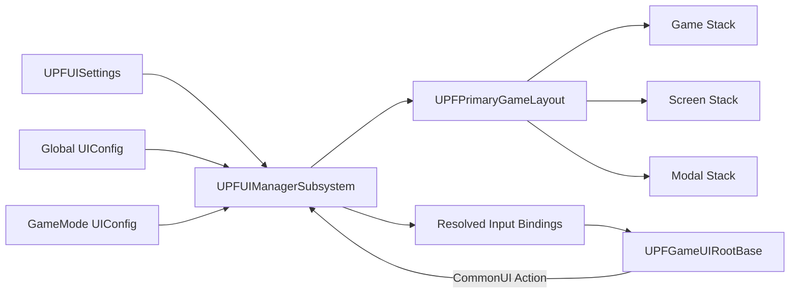
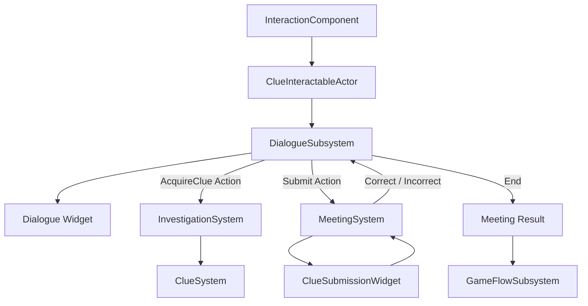

# Project SIH PDF 포트폴리오 제작 자료

이 문서는 10페이지 포트폴리오 중 Project SIH에 해당하는 **9–10페이지**의 원고와 시각 자료 가이드입니다. 상세 구현은 GitHub 문서로 넘기고, PDF에는 한 페이지당 한 개의 메시지와 3–4개의 근거만 남기는 구성을 전제로 합니다.

> 현재 포트폴리오 저장소에는 Blueprint, Data Asset, 맵, 프로젝트 설정이 없습니다. 아래 캡처는 공개 허용을 받은 원본 팀 프로젝트에서 직접 준비해야 하며, 미공개 기획 데이터·유료 에셋·다른 팀원의 화면 작업이 노출되지 않도록 확인해야 합니다.

## 9페이지 — Project SIH 소개 및 CommonUI

### 페이지 제목

**Project SIH — 모드별 UI를 하나의 CommonUI 진입점으로 관리**

### 핵심 메시지 한 문장

LocalPlayer 단위 UIManager가 GameMode별 Config를 해석하고, 의미 태그 하나로 HUD·Screen·Modal을 올리는 공통 UI 흐름을 구성했습니다.

### 핵심 구현 내용

1. `UPFUIManagerSubsystem`이 Controller/World 변경을 감지해 `UPFPrimaryGameLayout`을 생성·교체하고 현재 GameMode의 HUD를 표시합니다.
2. `UPFPrimaryGameLayout`은 Game, Screen, Modal의 세 `UCommonActivatableWidgetStack`을 Gameplay Tag Layer에 매핑합니다.
3. Global Config와 GameMode Config를 병합하되 같은 Widget ID와 입력 Action은 GameMode 설정을 우선합니다.
4. 각 위젯 정의의 CommonUI Action을 Root에서 동적으로 등록해 `입력 → WidgetID → ShowWidget → Layer Push`로 연결합니다.

### 추천 구조도

구조도에 반드시 넣을 실제 클래스:

- `UPFUISettings`
- `UPFUIConfig`, `FPFUIWidgetDefinition`
- `UPFUIManagerSubsystem`
- `UPFPrimaryGameLayout`
- `UPFGameUIRootBase`
- `UPFActivatableWidget`

### 추천 캡처 화면

- Unreal Editor의 PrimaryGameLayout WBP에서 Game/Screen/Modal Stack 세 개가 보이는 Designer 화면
- Project Settings의 GameMode별 UI Config 매핑 화면
- UI Config Data Asset에서 Widget ID, Widget Class, Open Input Action이 함께 보이는 Details 패널
- PIE에서 HUD 위에 Screen, 그 위에 Modal이 열린 장면 또는 CommonUI 디버그 화면

캡처에는 내부 폴더 전체 경로, 팀원 이름, 미공개 에셋이 보이지 않도록 자르고, 세 Stack에 같은 색상 라벨을 덧씌우는 편이 좋습니다.

### 실제 코드 근거

- [UIManagerSubsystem](../Project_SIH/003_UI/002_Subsystem/PFUIManagerSubsystem.cpp)
- [PrimaryGameLayout](../Project_SIH/003_UI/PFPrimaryGameLayout.cpp)
- [Config 기반 입력 등록](../Project_SIH/003_UI/000_Foundation/PFGameUIRootBase.cpp)
- [UI Config 계약](../Project_SIH/003_UI/001_Config/PFUIConfig.h)
- [입력 모드 기반 위젯](../Project_SIH/003_UI/000_Foundation/PFActivatableWidget.cpp)
- 상세 문서: [CommonUI 기반 UI 프레임워크](../Docs/CommonUI.md)

### 페이지 하단 상태 표기

- C++ 구조: 현재 코드로 확인
- WBP·Input DataTable·Config 실제 값: 분리 저장소에 없어 캡처 후 별도 검증
- 기여 근거: 원본 팀 Git의 `b6a1181`, `e144c2e`, `230186a`, `8f34c8a` (`Fsbsnw`)
- 공동 영역: 전투 HUD·파티 편성·결과 UI는 다른 작성자의 변경도 존재

### 면접 예상 질문

- LocalPlayerSubsystem을 선택한 이유와 GameInstanceSubsystem과의 차이는 무엇인가?
- Game/Screen/Modal을 Stack으로 나눈 기준과 Back 처리 순서는 무엇인가?
- Global/GameMode Config의 충돌 우선순위를 어떻게 결정했는가?
- Soft Class를 사용하면서 실제 로드는 왜 동기로 했고, 비동기 전환 시 구조를 어떻게 바꿀 것인가?
- `GetAuthGameMode`에 의존하는 현재 구현을 멀티플레이 클라이언트에서 어떻게 개선할 것인가?
- 런타임 Config가 바뀔 때 입력 바인딩을 어떻게 갱신할 것인가?

## 10페이지 — 조사·회의·대화 시스템

### 페이지 제목

**조사 결과를 대화 분기와 회의 판정으로 연결하는 데이터 중심 실행 구조**

### 핵심 메시지 한 문장

대화가 진행 순서와 Action 시점을 결정하고, 조사·회의 시스템은 도메인 판정 결과만 반환하도록 책임을 분리했습니다.

### 핵심 구현 내용

1. 범위 진입으로 등록한 단일 상호작용 대상을 `InteractionComponent`가 보관하고, 단서 액터가 직접 획득 또는 대화를 시작합니다.
2. `ClueSystem`은 획득·중복·순서 독립 조합·실패 재검토를, `MeetingSystem`은 Claim-Clue 판정과 공개 약점 누적을 담당합니다.
3. `DialogueSubsystem`은 Dialogue/Action/End 노드를 실행하고 Choice ID 또는 Action Result ID로 분기합니다.
4. `Action.Dialogue.AcquireClue`와 `Action.Dialogue.Submit`이 대화와 도메인 로직을 연결하며, 회의 종료 결과는 GameFlow에 전달됩니다.

### 추천 구조도

구조도에 반드시 넣을 실제 클래스:

- `UPFInteractionComponent`, `APFClueInteractableActor`
- `UPFInvestigationSystem`, `UPFClueSystem`, `UPFMeetingSystem`
- `UPFDialogueDefinition`, `UPFDialogueSubsystem`
- `UPFDialogueWidget`, `UPFClueSubmissionWidget`
- `UPFGameFlowSubsystem`

### 추천 캡처 화면

- 조사 맵에서 단서 액터 상호작용 범위와 대화 화면이 함께 보이는 PIE 화면
- Dialogue Data Asset의 Entry Node, Dialogue/Action/End 노드 데이터가 보이는 Details 화면
- 선택지 화면과 `Action.Dialogue.Submit` 뒤 단서 제출 화면을 나란히 배치한 캡처
- 정답 제출 후 공개 약점이 전투 UI에 반영된 장면이 있다면 조사→전투 연결 결과로 사용

현재 저장소에는 위 에셋이 없으므로 캡처만으로 구현 주체를 주장하지 말고, 해당 화면에서 본인이 구현한 C++ 경계를 콜아웃으로 표시하는 것이 안전합니다.

### 실제 코드 근거

- [상호작용 대상 관리](../Project_SIH/002_Systems/006_Interaction/PFInteractionComponent.cpp)
- [단서 대화 Action 연동](../Project_SIH/002_Systems/001_Investigation/PFClueInteractableActor.cpp)
- [단서 획득·조합](../Project_SIH/002_Systems/001_Investigation/PFClueSystem.cpp)
- [회의 판정·대화 연동](../Project_SIH/002_Systems/001_Investigation/PFMeetingSystem.cpp)
- [대화 Definition 검증](../Project_SIH/001_Data/000_Definitions/PFDialogueDefinition.cpp)
- [대화 실행 상태 머신](../Project_SIH/002_Systems/011_Dialogue/PFDialogueSubsystem.cpp)
- 상세 문서: [조사·상호작용·회의](../Docs/Investigation_Meeting.md), [대화 시스템](../Docs/Dialogue_System.md)

### 완료/테스트 중 표기

**구현 확인**

- 대화 노드·선택지·Action 결과 분기 C++
- 단서 획득·조합과 회의 판정 C++
- 조사·회의 Action 소비자 연결
- Meeting Result의 공개 약점 배열 전달

**테스트 또는 추가 확인 필요**

- Dialogue Widget은 코드상 테스트용 기반
- Clue Submission의 Claim 목록은 테스트 태그 두 개로 고정
- 실제 Dialogue/Clue/Case Data Asset과 WBP는 저장소에 없음
- 외부 HTML/그래프 데이터 제작 도구와 Import 파이프라인은 확인되지 않음
- 현재 Dialogue 구조 전용 자동화·PIE E2E 근거 없음

### 기여 범위 표기

- 개인 근거가 강한 영역: 원본 Git에서 `Fsbsnw` 커밋으로 확인되는 상호작용, 단서, 조사, 회의 로직
- 공동 영역: GameFlow, AssetManager 공통 기반, 전투 약점 적용
- 추가 확인 영역: 10월 22일 공개 스냅샷의 최종 DialogueSubsystem 구조는 기능별 원본 이력과 AI 보조 범위를 별도 확인해야 함

### 면접 예상 질문

- 대화와 MeetingSystem 중 어느 쪽이 선택지 순서와 종료 조건을 가져야 하는가?
- Action을 동기 함수 호출이 아니라 요청/완료 계약으로 만든 이유는 무엇인가?
- Action 델리게이트에서 단서 획득을 다음 Tick으로 미룬 이유는 무엇인가?
- 오래된 Choice와 Action 응답을 어떻게 차단하는가?
- 잘못된 대화 그래프를 런타임 전에 어떤 수준까지 검증하는가?
- 동일 약점 중복을 `TArray`로 보존한 이유와 전투 측 소비 계약은 무엇인가?
- 기획자가 수백 개 대화를 제작한다면 현재 Data Asset 구조에 어떤 Import·검증·프리뷰 도구를 추가할 것인가?

## 편집 메모

- 페이지당 코드 캡처는 최대 1개, 12–18줄 정도로 제한합니다.
- 9페이지는 UI Layer 구조도, 10페이지는 Dialogue Action 왕복 구조도를 가장 크게 배치합니다.
- “완료” 대신 `C++ 구현 확인`, `에셋 미포함`, `E2E 검증 필요`처럼 근거 수준을 명확히 표기합니다.
- 성능 수치, 제작 시간 단축률, 버그 감소율은 측정 자료가 없으므로 넣지 않습니다.
- 원본 팀 저장소의 커밋 링크·스크린샷은 공개 권한을 확인한 뒤 추가합니다.

