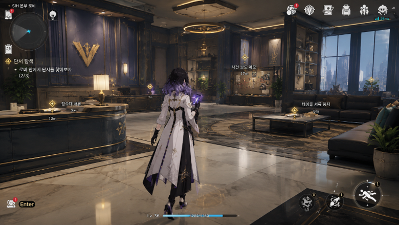
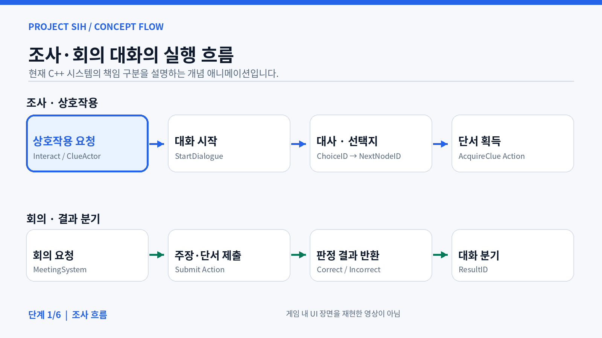

# Project SIH

**Unreal Engine C++ · 조사·추리 기반 턴제 RPG · 팀 프로젝트**

사건을 조사해 단서를 수집·조합하고, 회의에서 단서를 제출해 상대의 주장을 반박하는 게임을 개발 중입니다. CommonUI 기반 화면 관리와 조사·회의·대화 시스템의 C++ 흐름을 중심으로 작업했습니다.

## 목차

| 시스템 | 자세히 보기 |
| --- | --- |
| UI 프레임워크 | [CommonUI Framework](Docs/CommonUI.md) |
| 조사·상호작용·회의 | [Investigation & Meeting](Docs/Investigation_Meeting.md) |
| 대화 시스템 | [Dialogue System](Docs/Dialogue_System.md) |

> ### AI 컨셉 이미지
> 

## 대표 구현

### CommonUI 기반 UI 프레임워크

LocalPlayerSubsystem이 UI 진입점을 관리하고, CommonUI의 Game·Screen·Modal Stack으로 화면을 구분합니다. 공용 UI 설정과 GameMode별 설정을 통합하고 위젯별 입력 Action을 등록하도록 확장했습니다.

> ### SIH Common UI 구조
> 

[CommonUI 구현 보기](Docs/CommonUI.md)

### 조사·회의와 대화 시스템

단서 획득·조합과 회의 제출 판정을 게임플레이 시스템에 분리했습니다. DialogueSubsystem은 대사·선택지·Action·종료 노드를 실행하고, 외부 Action의 결과 ID를 받아 다음 대화 분기를 결정합니다.

> ### 대화 흐름(조사와 회의 방식의 구분)
> 

[조사·회의](Docs/Investigation_Meeting.md) · [대화 시스템](Docs/Dialogue_System.md)

> 이 저장소는 전체 게임이 아닌 C++ 소스 아카이브입니다.
