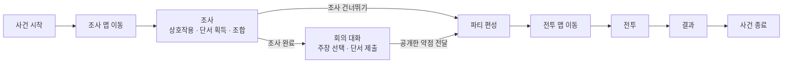
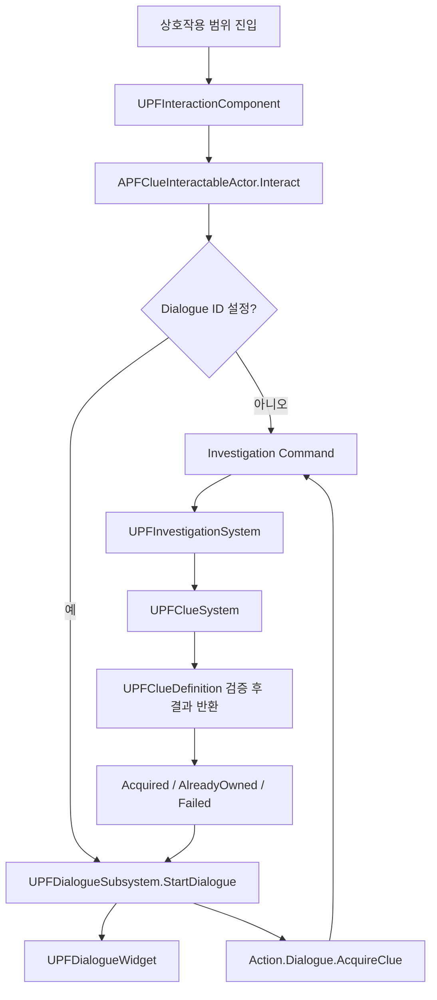

# Project SIH — C++ Technical Portfolio

Unreal Engine 기반 턴제 추리 게임 **Project SIH**에서 조사·회의·대화와 CommonUI 기반 화면 진입 구조를 중심으로 정리한 기술 포트폴리오입니다.

플레이어가 사건을 조사해 단서를 모으고, 회의에서 주장에 맞는 단서를 제출해 약점을 밝혀낸 뒤 전투로 전달하는 흐름을 C++ 시스템 경계와 데이터 계약 중심으로 설명합니다.

> 이 저장소는 실행 가능한 전체 프로젝트가 아니라 팀 프로젝트의 소스 일부를 분리한 코드 아카이브입니다. `.uproject`, Config, Blueprint, Data Asset, 맵이 포함되어 있지 않으므로 에셋 내부 설정과 실제 플레이 화면은 이 저장소만으로 검증할 수 없습니다.

## 빠른 탐색

| 문서 | 다루는 내용 |
| --- | --- |
| [CommonUI 구조](./Docs/CommonUI.md) | `UIManagerSubsystem`, `PrimaryGameLayout`, Game/Screen/Modal 계층, Config 기반 입력 등록 |
| [조사·상호작용·회의](./Docs/Investigation_Meeting.md) | 범위 상호작용, 단서 획득·조합, 회의 판정, GameFlow 결과 전달 |
| [대화 시스템](./Docs/Dialogue_System.md) | Dialogue/Action/End 노드 실행, 선택지와 분기, 외부 Action 연동, 현재 테스트 범위 |
| [PDF 9–10페이지 제작 자료](./PortfolioMaterials/PDF_Content.md) | 페이지별 메시지, 구조도, 캡처 후보, 코드 근거, 면접 질문 |

## 전체 게임 흐름

`UPFGameFlowSubsystem`이 사건과 페이즈 상태를 보관하고 Gameplay Message의 Ready/Completed 이벤트를 받아 월드별 시스템을 연결합니다. 조사 결과의 획득 단서는 회의 진입 컨텍스트로, 회의 결과의 공개 약점 배열은 이후 파티 편성·전투 컨텍스트로 전달됩니다.

## 핵심 구현 요약

### CommonUI

- `UPFUIManagerSubsystem`이 LocalPlayer 단위로 `UPFPrimaryGameLayout`의 생명주기와 GameMode별 UI Config를 관리합니다.
- `UPFPrimaryGameLayout`은 `UI.Layer.Game`, `UI.Layer.Screen`, `UI.Layer.Modal`을 각각 `UCommonActivatableWidgetStack`에 연결합니다.
- Global Config와 GameMode Config를 병합하되 같은 Widget ID와 입력 Action에서는 GameMode 설정을 우선합니다.
- `UPFGameUIRootBase`가 각 위젯 정의의 `Open Input Action`을 실행 시 등록하고, 입력을 Widget ID 기반 `ShowWidget` 요청으로 변환합니다.

### 조사·상호작용·회의

- `UPFInteractionComponent`는 범위 안의 단일 상호작용 대상을 보관하고 `IPFInteractableInterface` 호출을 전달합니다.
- `UPFClueSystem`은 단서 획득, 중복 방지, 순서 독립 조합, 성공·실패 시도 기록을 담당합니다.
- `UPFMeetingSystem`은 `주장 선택 → 단서 제출` 상태만 판정하고, 선택 지점과 다음 분기·종료 시점은 대화 데이터에 맡깁니다.
- 정답 단서가 공개한 약점은 배열에 누적되어 `FPFMeetingResult`로 방송됩니다.

### 대화

- `UPFDialogueDefinition`은 Entry Node와 `Dialogue / Action / End` 런타임 노드를 보관하고 시작 전에 참조 무결성을 검사합니다.
- `UPFDialogueSubsystem`은 한 월드에서 하나의 활성 대화를 실행하며 Line, Choices, Action 상태를 델리게이트로 UI와 외부 시스템에 전달합니다.
- 선택지는 `ChoiceID → NextNodeID`, Action은 `ResultID → NextNodeID` 계약으로 분기합니다.
- 단서 조사 Action은 `APFClueInteractableActor`, 회의 제출 Action은 `UPFMeetingSystem`이 실행한 뒤 결과 ID를 대화 런타임에 돌려줍니다.

## 대표 실행 흐름

## 구현 상태

| 영역 | 코드로 확인되는 상태 | 이 저장소에서 확인할 수 없는 범위 |
| --- | --- | --- |
| CommonUI 기반 계층·라우팅 | C++ 구현 확인 | Layout WBP의 Stack 바인딩, CommonInput DataTable, 실제 GameMode별 Config 값 |
| 상호작용·단서 획득·조합 | C++ 구현 확인 | 배치된 액터·충돌 설정·단서 Data Asset 값과 전체 플레이 검증 |
| 회의 판정·결과 전달 | C++ 구현 확인 | 실제 회의 Dialogue Asset, 모든 주장·단서 콘텐츠 조합의 E2E 검증 |
| 대화 런타임·선택지·Action 분기 | C++ 구현 확인 | Dialogue Data Asset, Blueprint 화면, 외부 그래프/HTML 제작 도구와 가져오기 파이프라인 |
| 대화 UI | 테스트용 C++ 기반 위젯 확인 | 최종 아트·포커스·패드 입력·로컬라이징·실기기 검증 |

현재 `UPFClueSubmissionWidget`의 주장 목록은 테스트 태그 두 개를 코드에서 생성하며, `UPFDialogueWidget`도 주석상 테스트용 CommonUI 기반입니다. 따라서 이 두 화면을 최종 콘텐츠 제작이 완료된 UI로 표현하지 않습니다.

## 코드 근거

- [CommonUI LocalPlayer 진입점](./Project_SIH/003_UI/002_Subsystem/PFUIManagerSubsystem.cpp)
- [Game/Screen/Modal 레이어](./Project_SIH/003_UI/PFPrimaryGameLayout.cpp)
- [Config 기반 입력 등록](./Project_SIH/003_UI/000_Foundation/PFGameUIRootBase.cpp)
- [조사·회의 시스템 진입점](./Project_SIH/002_Systems/001_Investigation/PFInvestigationGameMode.cpp)
- [단서 획득 및 조합](./Project_SIH/002_Systems/001_Investigation/PFClueSystem.cpp)
- [대화가 주도하는 회의 판정](./Project_SIH/002_Systems/001_Investigation/PFMeetingSystem.cpp)
- [대화 런타임](./Project_SIH/002_Systems/011_Dialogue/PFDialogueSubsystem.cpp)
- [대화 데이터 검증](./Project_SIH/001_Data/000_Definitions/PFDialogueDefinition.cpp)

## Git 이력과 기여 범위

### 이 저장소의 이력 상태

- 분석 기준: `main`의 `541c9e1` (2026-10-22)
- 현재 저장소에는 총 6개 커밋만 있으며, 비교한 원본 팀 저장소의 151개 커밋 이력이 승계되지 않았습니다. 남아 있는 기록은 9월 20일·10월 6일·10월 22일 기준 코드를 올린 **스냅샷 이력**입니다.
- 따라서 현재 저장소의 Git 작성자가 `Fsbsnw`라는 사실만으로 모든 포함 코드를 직접 작성했다고 판단할 수 없습니다. 원본 팀 프로젝트의 변경 단위·리뷰·공동 작업·AI 보조 여부도 이 저장소만으로는 복원되지 않습니다.
- `Project_SIH` 아래의 184개 `.h/.cpp`와 1개 Build.cs는 분석 시점의 로컬 원본 팀 프로젝트 작업본과 파일 해시가 일치했습니다. 다만 원본 저장소의 전체 커밋 계보는 이 저장소로 이전되지 않았습니다.

공개 저장소에서 확인 가능한 스냅샷은 [9월 20일 코드 업로드](../../commit/cc1dd0bd5456c49f5e456a6f861bf4dd155f998e), [10월 6일 코드 업로드](../../commit/210ab0755289ff70a8dce0bf375c659cff98d502), [10월 22일 코드 적용](../../commit/541c9e1d04c71e9c7b16bdaf5c212c8150d38d7d)입니다.

### 원본 팀 Git에서 확인한 `Fsbsnw` 변경 근거

| 범위 | 원본 커밋 근거 | 기여 해석 |
| --- | --- | --- |
| 조사·상호작용·단서·회의 | `ea1fa5e`, `15e0e1f`, `083df13`, `6eefb25`, `8696fb5`, `6f9b1c2`, `8ae5a41`, `d37159c` | 해당 기능 경로의 작성·확장 커밋이 `Fsbsnw`로 기록됨 |
| CommonUI 및 조사 UI | `b6a1181`, `e144c2e`, `230186a`, `8f34c8a` | UI Root, Config, Manager, 입력 라우팅 관련 변경이 `Fsbsnw`로 기록됨 |
| GameFlow·전투 연결 | 여러 작성자의 커밋이 함께 존재 | 팀 공용 시스템이며 `Fsbsnw`가 일부 연결부를 수정한 공동 영역 |
| 현재 대화 런타임 | 공개 스냅샷 `541c9e1`에서 대규모 교체 확인 | 원본의 세부 커밋 계보와 수동 작성·AI 보조 범위는 추가 확인 필요 |

위 표의 원본 커밋은 로컬 팀 저장소에서 확인한 근거입니다. 원본 저장소가 비공개라면 채용 담당자가 직접 열 수 있는 링크로 사용하지 말고, 공개 허용 여부를 확인한 뒤 별도 증빙을 준비해야 합니다.

## 분석 자료와 현재 코드의 일치 여부

- 2026-10-05 기준 기존 분석 자료의 CommonUI, 조사, 회의 책임 설명은 현재 C++ 구조와 대체로 일치합니다.
- 현재 코드는 2026-10-22 스냅샷에서 대화 그래프 프로토타입을 `UPFDialogueDefinition + UPFDialogueSubsystem` 구조로 교체했습니다. 기존 분석 자료는 이 최종 구조의 테스트 근거가 아닙니다.
- 현재 분리 저장소에는 Dialogue/Meeting/Clue 전용 자동화 테스트가 없고, GameFlow 결과 처리 테스트만 포함되어 있습니다. 원본 프로젝트의 과거 테스트 통과 기록은 현재 스냅샷의 재검증으로 간주하지 않았습니다.

## 공개 전 확인 체크리스트

- [ ] 원본 팀의 저장소·소스·기획 데이터 공개 동의를 받았는가
- [ ] `Fsbsnw` 외 작성자의 GameFlow, 전투, 캐릭터, 공용 AssetManager 코드가 필요한 최소 범위인지 검토했는가
- [ ] 공개 저장소에 남길 다른 팀원 코드의 저작권·표시 방식을 팀과 합의했는가
- [ ] `mermaid-diagram.png`의 제작자와 공개 권한을 확인했는가
- [ ] 원본 프로젝트의 Blueprint, Data Asset, 맵, 이미지, 음원, 폰트 등 비공개 에셋을 추가하지 않았는가
- [ ] 라이선스가 없는 상태로 팀 코드를 재배포해도 되는지 확인했는가
- [ ] 커밋 작성자와 실제 수동 작성 범위를 동일시하지 않고 AI 보조 범위를 별도로 확인했는가
- [ ] 캡처 화면에 내부 경로, 사용자명, 미공개 기획, 유료 에셋이 노출되지 않는가

현재 저장소에서 별도 에셋 파일로 확인되는 것은 `mermaid-diagram.png` 하나이며, `.uasset`, `.umap`, `.uproject`, `.ini`, HTML/JSON/CSV 제작 데이터는 포함되어 있지 않습니다.

## 사용 기술

- Unreal Engine C++
- CommonUI / CommonInput
- Gameplay Tags / Gameplay Message Subsystem
- LocalPlayer / World / GameInstance Subsystem
- Primary Data Asset / Asset Manager
- UObject Interface / Dynamic Multicast Delegate
